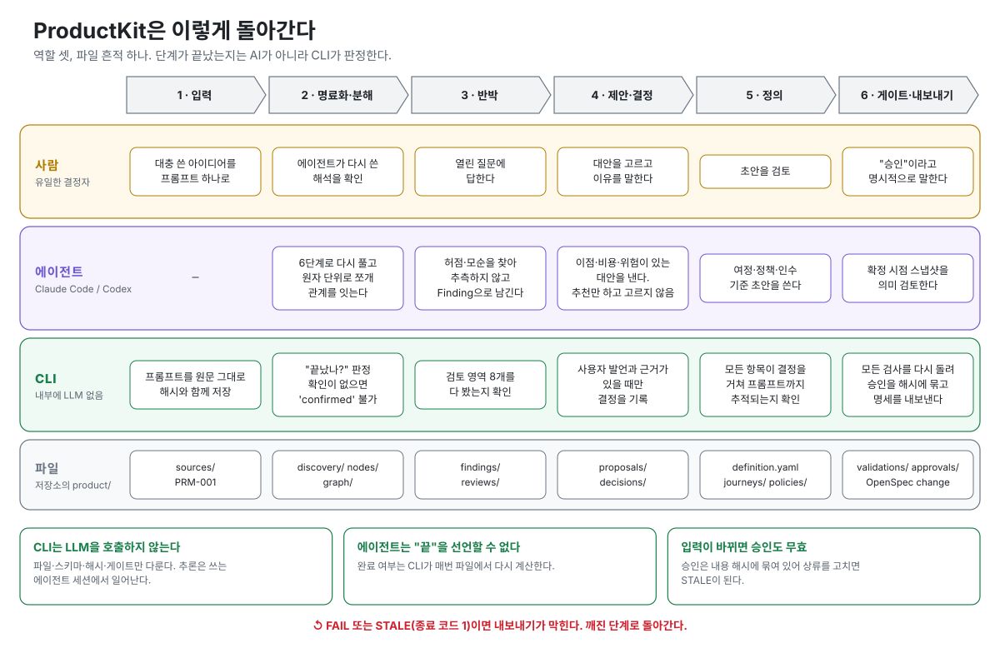

<div align="center">

# ProductKit

**한 줄짜리 아이디어를, 모든 결정에 근거 영수증이 붙은 Product Definition으로.**

Claude Code·Codex와 함께 쓰는 로컬 CLI + Agent Skills. AI가 묻고, 반박하고, 제안한다. 결정은 사람이 한다. ProductKit은 누가 무엇을 왜 결정했는지 기록한다.

[](LICENSE)
[](https://nodejs.org)
[](https://github.com/gilgim/productkit/tags)

[English](README.md) · 한국어

</div>

---

## 왜 만들었나

AI에게 "러닝 기록 공유 앱 만들어줘"라고 하면 빈칸을 전부 그럴듯하게 채워 준다. 몇 주 뒤에는 어떤 동작이 결정이었고 어떤 게 추측이었는지 아무도 모른다.

ProductKit은 아이디어와 명세 사이에 안전장치를 둔다.

- **AI의 추측은 결정이 되지 않는다.** `DEC-xxx`는 사용자가 근거와 함께 직접 말했을 때만 생긴다.
- **모르는 건 보이게 남긴다.** AI가 풀 수 없는 건 요구사항을 지어내지 않고 `FND-xxx` Finding과 질문으로 남는다.
- **양방향으로 추적된다.** Definition → Decision → Prompt 로 거슬러 올라가고, 반대로 원문의 모든 문장은 분해되거나, 질문으로 남거나, "요구사항 아님"으로 이유와 함께 사용자 동의를 받는다. 모든 Node는 Definition·기록된 제외·미해결 Finding 중 한 곳에 들어간다. 조용히 사라지는 건 없다 — 사라진 게 있으면 게이트가 이름을 댄다.
- **승인은 낡는다.** 승인 뒤에 입력이 바뀌면 승인이 무효가 된다.
- **CLI 안에 LLM이 없다.** CLI는 파일·스키마·검증만 맡는다. 추론은 쓰고 있는 Claude Code나 Codex 세션에서 일어나므로 별도 API 키도, 숨은 모델 호출도 없다.

## 동작 방식

<p align="center"></p>

각 단계가 정말 끝났는지는 CLI가 판정한다. 에이전트가 스스로 완료를 선언할 수 없다.

## 빠른 시작

Node.js 20.19 이상과 Git이 필요하다.

```bash
npm install --global "git+https://github.com/gilgim/productkit.git#v0.1.0-beta.2"
productkit --version        # 0.1.0-beta.2
```

설치가 끝이다. 설치하면서 Agent Skill 이 `~/.claude/skills` 와 `~/.agents/skills` 에 같이 복사되므로, Claude Code 나 Codex 를 다시 켜면 어느 프로젝트에서든 에이전트가 ProductKit 을 안다. 내 컴퓨터에서 빌드하는 단계는 없다 — `dist/` 가 저장소에 들어 있다.

> npm 레지스트리의 `productkit` 이름은 다른 프로젝트가 쓰고 있어서, 위처럼 GitHub 태그로 설치한다.

앱 폴더 안에 workspace를 만들고 아이디어를 넣는다.

```bash
cd ~/projects/my-app
productkit init
productkit intake "친구들과 러닝 기록을 공유하는 앱을 만들고 싶다"
productkit clarify
```

`clarify`는 내용을 대신 써 주지 않는다. 에이전트가 다음에 할 일을 알려 준다.

```text
Prompt saved: PRM-001
  product/sources/PRM-001.yaml

AI action required: Clarification has not started.
  Prompt:      product/sources/PRM-001.yaml
  Instruction: skills/clarify/SKILL.md
  Write to:    product/discovery/CLR-001.yaml
  Bind prompt_ref + prompt_content_hash in the clarification and new confirmation; do not invent user agreement.
```

일이 실제로 끝나기 전에는 게이트가 통과하지 않는다.

```text
$ productkit validate
PRODUCT READINESS BLOCKED
FAIL definition.required: Product Definition is missing.
```

따로 연결할 게 없다. `productkit init` 이 Skill 을 `.claude/skills/` 와
`.agents/skills/` 에 같이 써 준다. 그 폴더에서 Claude Code·Codex 를 다시 켜면
바로 잡힌다(원치 않으면 `--no-skills`, [설치 가이드](docs/installation.md)).

Claude Code에서 `/productkit-clarify`라고 말하고 질문에 답한다. 정의가 승인되면 내보낸다.

```bash
productkit export openspec --change <change-id> --capability <capability-id>
```

`export openspec`은 workspace에 OpenSpec CLI가 설치돼 있어야 한다. [설치 가이드](docs/installation.md#productkit-and-openspec)를 본다.

## 만들어지는 것

`productkit init`은 파일 기반 workspace를 만든다. Markdown과 YAML이라 diff와 PR 리뷰가 된다.

```text
product/
├── sources/      프롬프트 원문(수정 없이 보존)
├── discovery/    명료화: 누가·무엇을·왜·흐름
├── nodes/        원자적 요구사항
├── graph/        관계와 영향 분석
├── findings/     허점·가정·모순
├── proposals/    이점·비용·위험이 함께 적힌 대안
├── decisions/    사용자의 명시적 결정 + 근거
├── journeys/  policies/  assumptions/
├── validations/  semantic-reviews/  approvals/
└── exports/      OpenSpec export manifest
```

## 게이트가 잡는 것과 못 잡는 것

ProductKit은 자기 게이트를 상대로 공격 테스트를 했다. 왼쪽은 한때 READY까지 뚫렸다가 지금은 차단 검사 + 회귀 테스트가 된 것. 오른쪽은 구조상 열려 있는 것 — LLM 없는 로컬 CLI는 뜻과 신원을 판단할 수 없다.

| CLI가 잡는다 (readiness 차단) | 못 잡는다 — 사람이 읽어야 한다 |
|---|---|
| intake만 하고 clarify 안 한 Prompt | 엉뚱한 이유로 "요구사항 아님" 처리한 문장 |
| 분해도, 질문도, 이유 있는 제외도 안 된 원문 문장 | 맞는 span을 가리키면서 다른 말을 하는 분해 |
| Definition·제외 Decision·미해결 Finding 어디에도 없는 Node | 인용한 Node와 반대로 말하는 Definition 항목 |
| 없는·낡은·내용 다른 Decision을 가리키는 제외 항목 | Finding 내용과 실제로는 안 맞는 제외 범위 문구 |
| 증거 없이, 스킬 파일만으로, 또는 영역에 안 맞는 종류의 artifact로 `reviewed` 찍은 검토 | 그럴듯하지만 틀린 "요구사항 아님" 이유 — 사용자는 문장과 이유를 나란히 보지만, 읽는 건 사용자다 |
| 자기를 대상으로 하지 않는 Decision으로 resolved 된 Finding | 거짓인 `same` 판정 — 항목×Node 쌍마다 한 줄씩이라 거짓말도 N번, 이유까지 적어야 한다 |
| 요구사항·Acceptance Criteria가 하나도 없는 Definition | 에이전트가 불러주는 대로 받아 치는 사람 |
| 이전 검토가 unreviewed로 적은 항목을 슬쩍 뺀 검토 | 들어올 때부터 틀린 원문 |
| 터미널 입력이 필수인 워크스페이스에서 `--user-statement`로 넘긴 발언 | 에이전트가 해시까지 맞춰 손으로 위조한 파일 (`attestation: tty`도 결국 필드다) — `git diff`에만 보인다 |
| 원문 문장을 "질문 후보"에 넣어 두고 사용자 확인 Finding으로 올리지 않은 것 | |
| 에이전트가 쓴 Finding이 Node를 "잡고 있는" 것, Policy 인용으로 Node 배치를 때우는 것 | |
| artifact가 있는데 not_applicable 찍은 영역, 이전 미검토 항목을 뺀 다음 검토 | |
| supersedes 사슬 밖에서 "현재"인 척하는 두 번째 승인 | |
| 승인 뒤에 고친 모든 입력 (해시가 낡는다) | |

오른쪽이 짧아진 이유: 첫 공격 테스트 때는 "왜곡"과 "사칭"을 사람이 읽을 몫으로 남겼다. 그건 한계가 아니라 프로세스 구멍이었다. 지금은 사람이 무엇을 읽고 누가 입력하는지를 프로세스가 강제한다.

- **사용자는 에이전트의 요약이 아니라 CLI가 그린 것을 읽는다.** `productkit clarify`가 동의받을 블록을 찍는다: 원문 문장마다 해석을 짝지어, 제외한 문장은 이유와 함께, 질문으로 남긴 것도 전부. `clarify confirm`이 사용자 터미널에서 답을 받아 기록한다. 그 블록과 글자가 다른 확인은 확인이 아니다. 여러 문장을 하나로 읽거나 쉼표 많은 문장을 한 줄로 읽으려면 사용자가 보는 이유를 적어야 한다.
- **쌍마다 판정 하나.** semantic review는 Definition 항목과 그 항목이 인용한 Node 하나하나에 대해 same / narrower / broader / contradicts 와 이유를 적어야 한다. "전부 보존됨" 한 줄은 쓸 수 없다.
- **증거는 종류가 맞아야 한다.** `graph_impact`는 ImpactReport, `traceability`는 Decision과 Prompt. "뭔가 인용함"으로는 부족하다.
- **미검토 목록에서 떨어지는 게 없다.** 같은 입력에 대한 다음 검토는 이전 미검토 항목을 그대로 두거나 증거와 함께 해소해야 한다.
- **발언은 넘기는 게 아니라 치는 것이다.** 기본값 `attestation: tty`에서 `clarify confirm`·`challenge finding confirm`·`decide record`·`approve record`는 실행한 터미널에서 사용자 말을 직접 읽는다. 에이전트는 터미널이 없어 거부당하고, 명령을 사용자에게 넘긴다. `attestation: flag`로 바꿀 수는 있지만 `git diff`에 보이고 모든 보고에 경고가 붙는다.

스킬도 더는 손으로 적은 필드 목록을 들고 다니지 않는다. `productkit schema <artifact>`가 게이트가 검사하는 JSON Schema를 그대로 찍고, `productkit hash ...`가 게이트가 다시 계산하는 해시를 찍고, 스킬이 CLI에 없는 명령을 적으면 테스트가 빌드를 깨뜨린다.

남는 건 앞에 놓인 걸 읽고 자기 뜻을 치는 사람이다. 그게 ProductKit이 딛고 선 바닥이고, 이제 그 바닥만 남았다.

## 원칙

ProductKit은 11개 원칙을 지킨다([CONSTITUTION.md](CONSTITUTION.md)). 핵심은 다음과 같다.

1. AI 추론을 사용자 결정으로 기록하지 않는다.
2. 불명확한 사항은 추측하지 않고 Finding으로 남긴다.
3. 모든 결정에는 근거가 있다.
4. 모든 정의 항목은 원본 프롬프트까지 추적된다.
5. 원문의 모든 절은 포함되거나, 결정으로 제외되거나, 미해결 Finding으로 남는다. 조용히 사라지는 절은 없다.
6. 대안은 이점·비용·위험을 함께 보여 준다.
7. 해결되지 않은 Critical Finding이 있으면 Definition을 확정하지 않는다.
8. Product Definition과 구현 명세를 분리한다. DB 스키마나 API를 지어내지 않는다.

## 한계

- **v0 beta**다. 구조(파일·스키마·게이트·해시)는 자동 테스트 291개로 검증한다. 한때 READY까지 뚫렸던 공격을 그대로 옮긴 회귀 테스트가 포함돼 있다.
- 검증 통과는 **구조**가 맞다는 뜻이지 제품이 옳다는 보증이 아니다. 의미의 품질은 에이전트와 사람에게 달려 있다.
- coverage 게이트는 **빠짐**을 잡지 **틀림**을 잡지 않는다. 문장을 엉뚱한 이유로 "요구사항 아님"이라 적거나, Definition 항목이 원문 Node와 반대로 말해도 CLI는 모른다. export에 원문 Node 문장을 항목 옆에 같이 찍어 줄 뿐이다. 그 대조는 사람이 읽어야 한다.
- 검토 기록은 증거를 인용해야 검토로 치지만, 그 증거가 그 영역에 맞는 증거인지는 CLI가 판단 못 한다. "뭔가 인용했다"는 바닥선이지 기준이 아니다.
- CLI는 확인·승인을 누가 입력했는지 인증하지 못한다. 실제 사람이 말한 뒤에만 결정과 승인을 기록한다.

## 문서

| | |
|---|---|
| [CLI 레퍼런스](docs/cli.md) | 모든 명령·옵션·종료 코드 |
| [아키텍처](docs/architecture.md) | 역할 분리, 저장 구조, 게이트 |
| [Artifact 계약](docs/artifact-contracts.md) | 필드 단위 스키마 |
| [설치 가이드](docs/installation.md) | 태그 고정 설치, Skill, OpenSpec |
| [로드맵](docs/roadmap.md) | Change 01~09 |

## 개발

```bash
git clone https://github.com/gilgim/productkit.git && cd productkit
npm install && npm run build
npm test
```

이슈와 PR을 환영한다. ProductKit 자체의 개발은 OpenSpec(`openspec/changes/`)으로 관리한다.

## 라이선스

[MIT](LICENSE)
