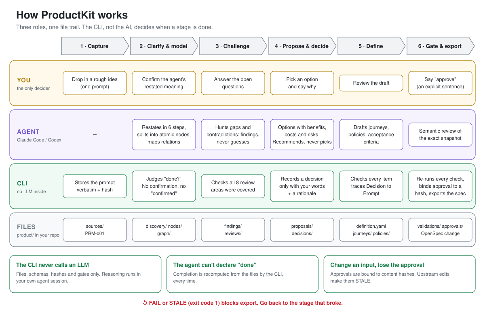

<div align="center">

# ProductKit

**Turn a one-line idea into a product definition where every decision has a receipt.**

A local CLI plus Agent Skills for Claude Code and Codex. The AI asks, challenges and proposes. You decide. ProductKit records who decided what, and why.

[](LICENSE)
[](https://nodejs.org)
[](https://github.com/gilgim/productkit/tags)

English · [한국어](README.ko.md)

</div>

---

## Why

Ask an AI to "build a running-log sharing app" and it will happily fill every blank with something plausible. Weeks later nobody can say which behavior was a decision and which was a guess.

ProductKit puts a guard rail between the idea and the spec:

- **AI guesses never become decisions.** A `DEC-xxx` exists only when *you* said so, with a rationale.
- **Unknowns stay visible.** What the AI can't resolve becomes a `FND-xxx` finding and a question, not an invented requirement.
- **Everything traces back.** Definition → Decision → Prompt. Your original words are preserved verbatim.
- **Approval goes stale.** Change an input after approving and the approval is invalidated.
- **No LLM inside the CLI.** The CLI only handles files, schemas and validation. Reasoning happens in your own Claude Code or Codex session, so there is no extra API key and no hidden model call.

## How it works

<p align="center"></p>

The CLI judges whether each stage is actually complete. The agent cannot declare itself done.

## Quick start

Requires Node.js 20.19+ and Git.

```bash
npm install --global "git+https://github.com/gilgim/productkit.git#v0.1.0-beta.1"
productkit --version        # 0.1.0-beta.1
```

> The name `productkit` on the npm registry belongs to another project, so install from the GitHub tag as above.

Create a workspace inside your app and feed it an idea:

```bash
cd ~/projects/my-app
productkit init
productkit intake "I want an app where friends share their running logs"
productkit clarify
```

`clarify` doesn't write anything for you. It tells your agent what to do next:

```text
Prompt saved: PRM-001
  product/sources/PRM-001.yaml

AI action required: Clarification has not started.
  Prompt:      product/sources/PRM-001.yaml
  Instruction: skills/clarify/SKILL.md
  Write to:    product/discovery/CLR-001.yaml
  Bind prompt_ref + prompt_content_hash in the clarification and new confirmation; do not invent user agreement.
```

The gate refuses to pass until the work is real:

```text
$ productkit validate
PRODUCT READINESS BLOCKED
FAIL definition.required: Product Definition is missing.
```

Nothing else to wire. `productkit init` writes the Skills into `.claude/skills/`
and `.agents/skills/`, so Claude Code and Codex pick them up on their next
start in that directory (`--no-skills` opts out; see the
[installation guide](docs/installation.md)).

Then, in Claude Code, say `/clarify` and answer the questions. When the definition is approved:

```bash
productkit export openspec --change <change-id> --capability <capability-id>
```

`export openspec` needs the OpenSpec CLI installed in your workspace; see the [installation guide](docs/installation.md#productkit-and-openspec).

## What you get

`productkit init` creates a plain-file workspace. Markdown and YAML, diffable, reviewable in a PR.

```text
product/
├── sources/      original prompts, preserved verbatim
├── discovery/    clarifications: who, what, why, flows
├── nodes/        atomic requirements
├── graph/        typed relations and impact analysis
├── findings/     gaps, assumptions, contradictions
├── proposals/    options with benefits, costs, risks
├── decisions/    your explicit choices + rationale
├── journeys/  policies/  assumptions/
├── validations/  semantic-reviews/  approvals/
└── exports/      OpenSpec export manifests
```

## Principles

ProductKit holds ten rules ([CONSTITUTION.md](CONSTITUTION.md)). The ones that matter most:

1. AI inference is never recorded as a user decision.
2. Unclear points become findings, not guesses.
3. Every decision carries a rationale.
4. Every definition item traces back to the original prompt.
5. Alternatives show benefits, costs and risks together, not just upsides.
6. An unresolved Critical finding blocks the definition.
7. Product definition and implementation spec stay separate. No invented schemas or APIs.

## Honest limits

- This is a **v0 beta**. The structure (files, schemas, gates, hashes) is covered by 248 automated tests.
- Passing validation proves **structure**, not that the product is right. Semantic quality depends on the agent and on you.
- The CLI cannot verify who typed a confirmation. Only record a decision or approval after a real human said it.

## Docs

| | |
|---|---|
| [CLI reference](docs/cli.md) | every command, option and exit code |
| [Architecture](docs/architecture.md) | roles, storage, gates |
| [Artifact contracts](docs/artifact-contracts.md) | field-level schemas |
| [Installation](docs/installation.md) | pinned install, Skills, OpenSpec |
| [Roadmap](docs/roadmap.md) | Change 01–09 |

## Development

```bash
git clone https://github.com/gilgim/productkit.git && cd productkit
npm install && npm run build
npm test
```

Issues and pull requests are welcome. ProductKit's own development is managed with OpenSpec (`openspec/changes/`).

## License

[MIT](LICENSE)
